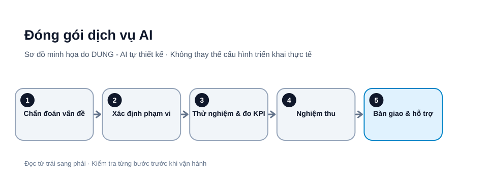

# Đóng gói dịch vụ AI cho doanh nghiệp nhỏ: phạm vi, KPI và nghiệm thu

Doanh nghiệp nhỏ thường không mua “AI” chỉ vì công nghệ mới. Họ cần giảm thời gian nhập liệu, chuẩn hóa phản hồi, tìm thông tin nhanh hơn hoặc giảm công việc lặp lại. Một dịch vụ AI có khả năng bán được nên bắt đầu từ vấn đề vận hành cụ thể, không phải danh sách tính năng.

Bài viết là khung thiết kế dịch vụ, không phải cam kết thu nhập hay bảo đảm có khách hàng.

*Hình 1. Đóng gói dịch vụ AI. Sơ đồ tự thiết kế bởi DUNG - AI; các bước và tên thành phần cần điều chỉnh theo môi trường thực tế.*

## 1. Chọn vấn đề có thể đo

Phỏng vấn người trực tiếp làm công việc. Hỏi việc nào lặp lại, mỗi lần mất bao lâu, đầu vào nằm ở đâu, lỗi thường gặp gây chi phí gì và ai có quyền phê duyệt đầu ra. Ưu tiên tác vụ có khối lượng đủ lớn, dữ liệu được phép sử dụng và kết quả dễ kiểm tra. Tránh khởi đầu bằng quyết định tuyển dụng, tín dụng, y tế hoặc hành động có hậu quả lớn.

## 2. Chuyển giải pháp thành gói dịch vụ

| Thành phần | Ví dụ cần ghi rõ |
|---|---|
| Vấn đề | Phân loại yêu cầu từ biểu mẫu |
| Đầu vào | CSV/biểu mẫu đã thống nhất |
| Đầu ra | Bản nháp phân loại, không tự gửi |
| Phạm vi | Một phòng ban, một quy trình |
| Ngoài phạm vi | Tự quyết định hoàn tiền |
| Bàn giao | Workflow, tài liệu, hướng dẫn |
| Hỗ trợ | Thời hạn, kênh và giờ phản hồi |

Có thể chia thành khảo sát và bản đồ quy trình; thử nghiệm giới hạn; triển khai có giám sát. Mỗi giai đoạn có tiêu chí dừng riêng.

## 3. Đặt KPI trước khi xây

Chọn chỉ số lấy được từ dữ liệu: thời gian xử lý trung vị; tỷ lệ đầu ra được chấp nhận mà không cần sửa lớn; tỷ lệ lỗi nghiêm trọng; tỷ lệ cần con người can thiệp; chi phí trên một đầu ra đạt chuẩn; số lần workflow lỗi hoặc chạy trùng.

Đo baseline trong khoảng thời gian đại diện. So sánh cùng loại công việc và cùng tiêu chí. Không dùng số token hoặc số lượt gọi AI làm đại diện cho giá trị kinh doanh.

## 4. Tính giá và biên lợi nhuận

TCO có thể gồm công triển khai, bảo trì, hạ tầng, API, hỗ trợ và dự phòng rủi ro. Giá bán cần bù chi phí, thời gian quản lý và nghĩa vụ hỗ trợ. Với công cụ có quota miễn phí, không giả định quota đó sẽ đủ mãi mãi. Ghi rõ ai sở hữu tài khoản, ai chịu phí vượt hạn mức và phải xin phép trước khi bật dịch vụ trả phí.

Không cam kết tiết kiệm phần trăm cố định nếu chưa đo. Thử nghiệm có thể không cải thiện; đó vẫn là dữ liệu để quyết định dừng hoặc thiết kế lại.

## 5. Hợp đồng và nghiệm thu

Tài liệu nghiệm thu nên xác định dữ liệu nào được xử lý và lưu ở đâu; thời gian lưu; quyền truy cập; điều kiện đầu vào hợp lệ; bộ test và ngưỡng chất lượng; trường hợp chuyển người xử lý; giới hạn trách nhiệm khi nguồn dữ liệu hoặc dịch vụ bên thứ ba thay đổi; quy trình bàn giao và kết thúc dịch vụ.

Khách hàng phải có quyền kiểm tra và phê duyệt trước khi workflow gửi thông tin ra ngoài hoặc ghi vào hệ thống chính thức.

## Mẫu phạm vi công việc (SOW) một trang

Ví dụ minh họa: dịch vụ phân loại yêu cầu hỗ trợ gửi từ biểu mẫu. Các mục tiêu và số liệu phải được đo lại với khách hàng; không phải cam kết hiệu quả.

| Mục | Nội dung cần chốt |
|---|---|
| Vấn đề | Nhân viên mất thời gian đọc và gán nhóm cho yêu cầu |
| Phạm vi thử nghiệm | Một biểu mẫu, ba nhóm yêu cầu, một nhóm vận hành |
| Đầu vào | Nội dung biểu mẫu đã loại dữ liệu không cần thiết |
| Đầu ra | Nhãn đề xuất, lý do, mức độ chắc chắn và bản nháp phản hồi |
| Hành động bị cấm | Tự gửi email, tự hoàn tiền, tự thay đổi hồ sơ khách hàng |
| Người duyệt | Nhân viên phụ trách từng yêu cầu |
| KPI | Độ chính xác nhãn, tỷ lệ phải sửa, thời gian xử lý, lỗi nghiêm trọng |
| Bàn giao | Workflow, tài liệu cấu hình, bộ test, hướng dẫn dừng và khôi phục |
| Dữ liệu | Nơi lưu, người được truy cập, thời hạn lưu và cách xóa |
| Chi phí | Phí triển khai, phí vận hành, quota, ngưỡng cảnh báo và ai chịu chi phí vượt |
| Nghiệm thu | Bộ test, ngưỡng đạt, thời gian đo và người ký xác nhận |
| Ngoài phạm vi | Tích hợp CRM khác, xử lý dữ liệu nhạy cảm, tự động gửi ra ngoài |

### Ví dụ tiêu chí nghiệm thu thử nghiệm

- Dùng 100 yêu cầu giả lập hoặc dữ liệu lịch sử đã được phép dùng.
- Nhân viên đánh giá nhãn và bản nháp theo rubric đã thống nhất.
- Mục tiêu thử nghiệm giả định: ít nhất 90/100 nhãn đúng; không có hành động gửi email tự động; mọi trường hợp thiếu dữ liệu được gắn cờ để con người xem.
- Nếu không đạt ngưỡng hoặc phát hiện lỗi nghiêm trọng, dừng mở rộng, phân tích nguyên nhân và thống nhất vòng thử tiếp theo.

Không dùng ngưỡng 90/100 như tiêu chuẩn chung. Khách hàng phải duyệt ngưỡng theo rủi ro và chi phí của một lỗi.

## 6. Bài tập tạo đề xuất một trang

Dùng một quy trình thật nhưng dữ liệu giả lập. Viết một trang gồm vấn đề, baseline, phạm vi thử nghiệm, đầu ra, KPI, rủi ro, chi phí dự kiến, điều kiện dừng và tiêu chí nghiệm thu. Đưa đề xuất cho người vận hành phản biện trước khi xây.

## Checklist

- [ ] Vấn đề có người chịu trách nhiệm và baseline.
- [ ] Đầu vào, đầu ra và phần ngoài phạm vi rõ.
- [ ] KPI đo chất lượng lẫn hiệu quả.
- [ ] Có human approval.
- [ ] TCO gồm bảo trì và chi phí vượt quota.
- [ ] Tiêu chí nghiệm thu và dừng dự án được thống nhất.

## Nguồn tham khảo

- [NIST AI Risk Management Framework](https://www.nist.gov/itl/ai-risk-management-framework) — NIST cho biết AI RMF 1.0 đang được sửa đổi; dùng khung này cho quản trị rủi ro và kiểm tra Playbook/cập nhật mới nhất trước khi triển khai.
- [OECD AI Principles](https://oecd.ai/en/ai-principles) — được cập nhật tháng 05/2024; dùng làm nguyên tắc quản trị AI, không thay thế pháp luật áp dụng tại địa phương.
- [Google Cloud – Generative AI adoption framework](https://cloud.google.com/blog/products/ai-machine-learning/build-a-transformative-ai-capability-with-ai-adoption-framework) — bài nền tảng đăng ngày 30/06/2020; dùng để tham khảo các nhóm năng lực tổ chức (công nghệ, con người, dữ liệu, quy trình), không xem là hướng dẫn cập nhật sản phẩm hoặc chính sách năm 2026.

*Bài viết cung cấp khung tham khảo, không phải tư vấn pháp lý hoặc cam kết hiệu quả tài chính. Khi sử dụng lại nội dung, vui lòng ghi rõ tác giả: DUNG - AI.*
