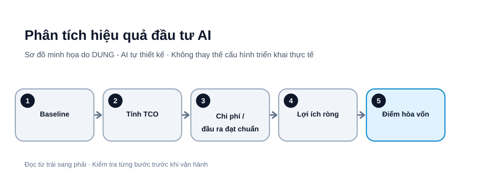

# Tính điểm hòa vốn cho dự án AI: TCO, chi phí mỗi kết quả và thời gian hoàn vốn

Một công cụ AI có gói miễn phí không đồng nghĩa dự án sử dụng nó miễn phí. Nhân sự vẫn phải chuẩn bị dữ liệu, kiểm tra kết quả, sửa lỗi, quản lý quyền và bảo trì workflow. Muốn biết AI có đáng triển khai không, cần tính tổng chi phí sở hữu (TCO) và so sánh với lợi ích đo được.




*Hình 1. Phân tích hiệu quả đầu tư AI. Sơ đồ tự thiết kế bởi DUNG - AI; các bước và tên thành phần cần điều chỉnh theo môi trường thực tế.*

## 1. Xác định đơn vị kết quả

Chọn đơn vị nghiệp vụ rõ, ví dụ một yêu cầu được phân loại đúng và được nhân viên chấp nhận. Không dùng “một lần gọi AI” làm đơn vị giá trị nếu kết quả có thể sai hoặc cần sửa. Ghi baseline: số lượng công việc mỗi tháng, thời gian xử lý thủ công, chi phí lao động theo giờ và tỷ lệ lỗi hiện tại.

## 2. Tính TCO

~~~text
TCO tháng = nền tảng + API + hạ tầng + giờ vận hành
          + giờ kiểm tra + bảo trì + dự phòng rủi ro
~~~

Tách chi phí một lần (thiết kế, tích hợp, đào tạo) khỏi chi phí định kỳ (hosting, token, hỗ trợ, cập nhật). Nếu dùng quota miễn phí, ghi quota, ngày reset và chi phí khi vượt ngưỡng; không coi quota là vô hạn.

## 3. Tính chi phí trên đầu ra đạt chuẩn

Ví dụ giả định:

- 1.000 yêu cầu/tháng.
- Workflow tạo 1.000 bản nháp.
- 850 bản được chấp nhận sau kiểm tra.
- Tổng chi phí AI, hạ tầng và vận hành: 2.550.000 đồng.

Chi phí trên đầu ra đạt chuẩn = 2.550.000 / 850 = 3.000 đồng. Nếu chia cho 1.000 lần chạy, kết quả là 2.550 đồng nhưng bỏ qua 150 bản không đạt. Vì vậy, chi phí trên kết quả được chấp nhận phản ánh chất lượng tốt hơn.

## 4. Ước tính lợi ích ròng

Giả sử quy trình cũ cần 6 phút cho mỗi yêu cầu. Sau khi áp dụng AI, thời gian nhân sự dành cho kiểm tra, sửa hoặc xử lý thủ công còn trung bình 2 phút trên toàn bộ 1.000 yêu cầu (đã tính cả trường hợp đầu ra không đạt phải xử lý tiếp). Thời gian được giải phóng là 1.000 × (6 - 2) = 4.000 phút. Con số 850 đầu ra đạt chuẩn dùng để tính chi phí trên kết quả được chấp nhận, không dùng thay cho tổng số tác vụ khi tính thời gian.

Quy đổi thành giờ rồi nhân chi phí lao động phù hợp. Trừ TCO, chi phí chuyển đổi và công việc phát sinh. Không coi thời gian tiết kiệm là tiền mặt nếu doanh nghiệp chưa thực sự tái phân bổ được nguồn lực đó.

## 5. Điểm hòa vốn và hoàn vốn

Để tính điểm hòa vốn theo sản lượng, tách chi phí cố định trong kỳ khỏi chi phí biến đổi trên mỗi đầu ra đạt chuẩn. Ví dụ, chi phí cố định gồm nền tảng, phần hạ tầng cố định và phần chi phí triển khai được phân bổ; chi phí biến đổi gồm API/token, xử lý và kiểm tra tăng thêm theo từng kết quả.

```text
Số đầu ra đạt chuẩn hòa vốn
= Chi phí cố định trong kỳ
  / (Lợi ích tiền mặt tăng thêm trên mỗi đầu ra đạt chuẩn
     - Chi phí biến đổi trên mỗi đầu ra đạt chuẩn)
```

Chỉ dùng công thức khi mẫu số dương và lợi ích tiền mặt trên mỗi đầu ra có thể chứng minh. Nếu mẫu số bằng hoặc nhỏ hơn 0, tăng sản lượng không làm dự án hòa vốn theo mô hình này; cần giảm chi phí, cải thiện chất lượng hoặc thiết kế lại dịch vụ. Không đưa giờ công được giải phóng vào “lợi ích tiền mặt” nếu doanh nghiệp chưa thực sự giảm chi hoặc tạo thêm doanh thu.

Ví dụ giả định: chi phí cố định là 6.000.000 đồng/tháng; mỗi đầu ra đạt chuẩn giúp giảm 20.000 đồng chi phí tiền mặt; chi phí biến đổi là 8.000 đồng/đầu ra. Điểm hòa vốn là 6.000.000 / (20.000 - 8.000) = 500 đầu ra đạt chuẩn/tháng. Đây chỉ là phép tính minh họa; phải đo các biến bằng dữ liệu pilot.

Nếu chi phí triển khai ban đầu là 12 triệu đồng và lợi ích ròng tiền mặt hàng tháng sau vận hành là 3 triệu đồng, thời gian hoàn vốn đơn giản là 12 / 3 = 4 tháng. Đây là chỉ số hoàn vốn, khác với sản lượng hòa vốn định kỳ ở trên. Cần kiểm tra lợi ích có lặp lại và chi phí có ổn định không.

Với sản lượng biến động, lập ba kịch bản: thận trọng, cơ sở và tích cực. Thay đổi tỷ lệ chấp nhận, số lượng công việc, chi phí API và thời gian kiểm tra. Nếu kịch bản thận trọng vẫn lỗ, không nên mở rộng chỉ vì kịch bản tích cực đẹp.

## Mẫu bảng tính theo dõi hàng tháng

Tạo một sheet với các cột sau. Mỗi dòng là một tháng hoặc một nhóm tác vụ đồng nhất:

| Cột | Trường | Ý nghĩa |
|---|---|---|
| A | Tháng | Kỳ đo |
| B | Tổng tác vụ | Số tác vụ được tiếp nhận |
| C | Đầu ra đạt chuẩn | Số kết quả được chấp nhận sau kiểm tra |
| D | Phân bổ chi phí triển khai | Chi phí một lần phân bổ theo kỳ |
| E | API/model | Chi phí model và API |
| F | Hạ tầng | Hosting, lưu trữ, logging |
| G | Giờ kiểm tra | Thời gian con người kiểm tra/sửa |
| H | Chi phí giờ kiểm tra | Chi phí lao động theo giờ |
| I | Giờ bảo trì | Thời gian vận hành, xử lý lỗi |
| J | Chi phí giờ bảo trì | Chi phí lao động theo giờ |
| K | TCO kỳ | Tổng chi phí kỳ |
| L | Chi phí/đầu ra đạt chuẩn | TCO chia số đầu ra đạt chuẩn |
| M | Phút thủ công/tác vụ | Baseline trước AI |
| N | Phút nhân sự sau AI/tác vụ | Trung bình trên toàn bộ tác vụ, gồm đầu ra bị từ chối và xử lý thủ công bổ sung |
| O | Giờ công được giải phóng | Tổng tác vụ × (M−N) / 60; N là thời gian nhân sự trung bình sau AI trên toàn bộ tác vụ |
| P | Lợi ích tiền mặt xác minh | Chỉ phần thực sự giảm chi hoặc tạo doanh thu tăng thêm |
| Q | Lợi ích ròng tiền mặt | P trừ TCO |

Ví dụ công thức Google Sheets tại dòng 2:

```text
K2 = D2 + E2 + F2 + G2*H2 + I2*J2
L2 = IFERROR(K2/C2, 0)
O2 = B2*(M2-N2)/60
Q2 = P2-K2
```

Có thể thêm ROI tiền mặt:

```text
ROI = IFERROR((P2-K2)/K2, 0)
```

Định dạng ô ROI thành phần trăm. Công thức chỉ là mẫu; kiểm tra dấu phân cách hàm theo locale Google Sheets của bạn.

### Phân biệt ba loại lợi ích

- **Giờ công được giải phóng:** năng lực nhân viên có thể dùng cho công việc khác; công thức trong sheet phải tính trên toàn bộ tác vụ (cột B) và thời gian nhân sự trung bình thực tế sau AI (cột N), không chỉ số đầu ra đạt chuẩn; chưa chắc là khoản tiền mặt tiết kiệm.
- **Tiết kiệm tiền mặt:** chi phí thực tế giảm, ví dụ giảm thuê ngoài hoặc giảm làm thêm giờ có chứng từ.
- **Giá trị tăng thêm:** doanh thu, chất lượng dịch vụ hoặc giảm rủi ro; cần cách đo và nguồn dữ liệu riêng.

Không cộng cả ba loại vào một con số nếu chúng chồng lặp. Khi tính ROI tài chính, chỉ dùng lợi ích tiền mặt có thể chứng minh hoặc quy đổi giá trị đã được doanh nghiệp phê duyệt.

### Phân tích ba kịch bản

| Biến số | Thận trọng | Cơ sở | Tích cực |
|---|---|---|---|
| Tỷ lệ đầu ra đạt chuẩn | Thấp hơn baseline dự kiến | Theo kết quả pilot | Cao hơn nhưng có bằng chứng |
| Thời gian kiểm tra | Cao | Trung vị đo được | Thấp hơn nhưng đã kiểm chứng |
| Chi phí API | Có dự phòng vượt quota | Theo hóa đơn pilot | Chỉ giảm nếu có cam kết/đo lường |
| Sản lượng | Thấp | Sản lượng hiện tại | Tăng theo nhu cầu thực |
| Quyết định | Có thể dừng | Mở rộng có điều kiện | Chỉ mở rộng khi không giảm chất lượng |

Tính lại TCO, chi phí mỗi đầu ra và lợi ích ròng cho cả ba kịch bản. Không chọn kịch bản tích cực làm dự báo chính nếu chưa có dữ liệu vận hành.

## 6. Quyết định mở rộng hay dừng

Mở rộng khi chất lượng đạt ngưỡng, lợi ích ròng dương qua nhiều chu kỳ và rủi ro được kiểm soát. Sửa quy trình khi lỗi tập trung ở một nhóm đầu vào. Dừng khi chi phí kiểm tra vượt phần tiết kiệm hoặc dữ liệu không đáp ứng điều kiện sử dụng.

## Bảng theo dõi tối thiểu

| Chỉ số | Trước AI | Sau AI |
|---|---:|---:|
| Số tác vụ | | |
| Phút xử lý trung vị | | |
| Tỷ lệ đạt chuẩn | | |
| Lỗi nghiêm trọng | | |
| Chi phí / kết quả đạt chuẩn | | |
| Giờ bảo trì / tháng | | |

## Checklist

- [ ] Có baseline và đơn vị kết quả.
- [ ] TCO gồm công kiểm tra, bảo trì và chi phí vượt quota.
- [ ] Chỉ tính đầu ra được chấp nhận.
- [ ] Tách lợi ích tiền mặt và thời gian được giải phóng.
- [ ] Có kịch bản thận trọng.
- [ ] Đặt điều kiện mở rộng và dừng.

## Nguồn tham khảo

- [NIST AI Risk Management Framework](https://www.nist.gov/itl/ai-risk-management-framework) — dùng cho quản trị rủi ro và kiểm soát triển khai; đây không phải công thức kế toán TCO. NIST cho biết AI RMF 1.0 đang được sửa đổi.
- [FinOps Foundation – Unit Economics](https://www.finops.org/framework/capabilities/unit-economics/) — hướng dẫn xác định unit metrics và liên hệ chi phí công nghệ với giá trị sản phẩm/dịch vụ.
- [Google Cloud – Pricing calculator](https://cloud.google.com/products/calculator) — công cụ ước tính riêng dịch vụ Google Cloud; không thay thế báo giá của nhà cung cấp khác hoặc phép tính TCO đầy đủ gồm nhân công, bảo trì, kiểm tra và chi phí vận hành.

*Các số liệu trong ví dụ là giả định minh họa. Khi sử dụng lại nội dung, vui lòng ghi rõ tác giả: DUNG - AI.*
