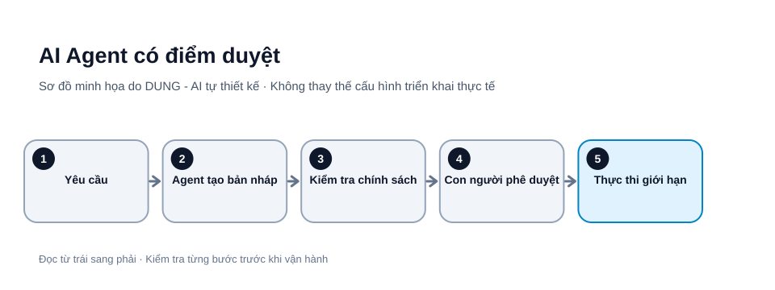

# Thiết kế AI Agent an toàn: quyền tối thiểu và điểm duyệt của con người

AI Agent có thể lập kế hoạch, gọi công cụ và thực hiện nhiều bước. Một lỗi suy luận có thể dẫn đến gửi email, sửa dữ liệu hoặc xóa tài nguyên. Thiết kế an toàn không phải cấm mọi tự động hóa, mà là cấp đúng quyền cho đúng bước và giữ con người ở những điểm có hậu quả đáng kể.




*Hình 1. AI Agent có điểm duyệt. Sơ đồ tự thiết kế bởi DUNG - AI; các bước và tên thành phần cần điều chỉnh theo môi trường thực tế.*

## 1. Tách đề xuất, chuẩn bị và thực thi

- **Đề xuất:** Agent đọc dữ liệu được phép và tạo kế hoạch.
- **Chuẩn bị:** hệ thống kiểm tra schema, quyền, đối tượng, phạm vi và tác động dự kiến.
- **Thực thi:** dịch vụ riêng chỉ chạy hành động đã được cho phép.

Không để mô hình tự quyết định rằng nó đã được cấp quyền. Quyền phải đến từ cấu hình và hệ thống xác thực bên ngoài.

## 2. Áp dụng quyền tối thiểu

Ví dụ Agent hỗ trợ khách hàng:

| Tác vụ | Quyền khởi đầu |
|---|---|
| Đọc hướng dẫn công khai | Cho phép |
| Đọc hồ sơ được phân quyền | Chỉ đọc |
| Soạn câu trả lời | Tạo bản nháp |
| Gửi email | Cần người duyệt |
| Hoàn tiền / đổi hợp đồng | Cấm tự động |
| Xóa hồ sơ | Quy trình riêng |

Dùng tài khoản dịch vụ riêng, token có scope hẹp, thời hạn ngắn và có thể thu hồi. Không đặt API key trong prompt, bài viết hoặc log.

## 3. Dùng state machine

Một luồng trạng thái có thể là:

~~~text
NEW → ANALYZED → DRAFT_READY → WAITING_APPROVAL
    → APPROVED → EXECUTED
                     ↘ FAILED
    ↘ REJECTED / NEEDS_INFO / EXPIRED
~~~

Chỉ cho phép chuyển trạng thái theo quy tắc xác định. Ví dụ DRAFT_READY không được nhảy thẳng sang EXECUTED nếu hành động cần phê duyệt.

## 4. Màn hình duyệt phải có đủ thông tin

Người duyệt cần thấy hành động dự kiến, lý do, tài khoản hoặc bản ghi bị tác động, nội dung sẽ gửi, tác động có thể đảo ngược hay không, nguồn dữ liệu và điểm chưa chắc chắn. Phê duyệt phải gắn với đúng payload; nếu Agent sửa nội dung sau khi duyệt, yêu cầu duyệt lại.

Không dùng một nút “Duyệt tất cả” cho nhiều hành động có mức rủi ro khác nhau.

## Mẫu payload phê duyệt gắn với đúng hành động

Ví dụ một yêu cầu gửi email đang chờ người duyệt (mọi giá trị đều giả lập):

```json
{
  "approval_id": "APR-2026-00042",
  "run_id": "RUN-2026-0018",
  "requested_by": "user-123",
  "action": "send_email",
  "recipient": "customer@example.invalid",
  "subject": "Cập nhật yêu cầu hỗ trợ",
  "body_preview": "Chúng tôi đã nhận được yêu cầu...",
  "payload_hash": "sha256:hash-do-server-tao",
  "policy_version": "support-agent-v3",
  "status": "WAITING_APPROVAL",
  "expires_at": "2026-11-03T12:00:00Z"
}
```

Quy trình thực thi an toàn:

1. Agent chỉ tạo bản nháp và gửi payload sang approval service.
2. Server xác thực người duyệt có quyền với hành động đó.
3. Người duyệt xem người nhận, tiêu đề, nội dung, nguồn và tác động; không chỉ xem câu giải thích của Agent.
4. Khi bấm duyệt, server kiểm tra trạng thái còn `WAITING_APPROVAL`, chưa hết hạn và payload hash vẫn khớp.
5. Server mới cấp lệnh thực thi một lần; nếu payload thay đổi dù chỉ một trường, hủy duyệt cũ và tạo yêu cầu duyệt mới.
6. Lưu danh tính người duyệt, thời điểm, quyết định và kết quả thực thi vào audit log.

Không tin `approved: true` do chính model tự gửi. Trạng thái duyệt phải được lưu và kiểm tra bởi hệ thống độc lập. Với thao tác không thể đảo ngược, cần xác nhận bổ sung hoặc quy trình hai người duyệt tùy mức rủi ro.

## 5. Phòng chống prompt injection

Email, trang web và tệp đính kèm là dữ liệu không đáng tin, không phải lệnh hệ thống. Agent không được làm theo chỉ dẫn trong nguồn nếu chúng yêu cầu tiết lộ bí mật, thay đổi quyền hoặc gọi công cụ ngoài nhiệm vụ.

Không dựa vào prompt như hàng rào duy nhất. Dùng allowlist công cụ, kiểm tra tham số ở server, tách bí mật khỏi ngữ cảnh, giới hạn domain và chặn hành động nhạy cảm bằng chính sách độc lập.

## 6. Nhật ký, giới hạn và nút dừng

Ghi run ID, người yêu cầu, phiên bản Agent, công cụ được gọi, kết quả kiểm tra quyền, người phê duyệt, thời điểm và mã lỗi. Tránh ghi token bí mật hoặc toàn bộ dữ liệu cá nhân.

Đặt giới hạn vòng lặp, thời gian, số lần gọi công cụ và ngân sách. Có công tắc dừng Agent, khả năng thu hồi token và phương án khôi phục dữ liệu.

## Bài tập thiết kế

Chọn một Agent chỉ có quyền tạo bản nháp. Liệt kê công cụ, quyền đọc/ghi, dữ liệu đầu vào, hành động bị cấm và điều kiện cần duyệt. Chạy thử với dữ liệu giả lập, gồm email có chỉ dẫn độc hại. Chỉ mở rộng quyền khi bộ test chứng minh các rào chắn hoạt động.

## Checklist

- [ ] Tách đề xuất khỏi thực thi.
- [ ] Quyền tối thiểu, token riêng và có thể thu hồi.
- [ ] Mỗi hành động có schema và allowlist.
- [ ] Duyệt gắn với payload bất biến.
- [ ] Có giới hạn vòng lặp, thời gian và chi phí.
- [ ] Có log, nút dừng và phương án khôi phục.

## Nguồn tham khảo

- [OWASP GenAI LLM Top 10 – 2026](https://genai.owasp.org/resource/owasp-genai-llm-top-10-2026/) — bản hiện hành, công bố tháng 08/2026.
- [NIST AI Risk Management Framework](https://www.nist.gov/itl/ai-risk-management-framework)
- [OpenAI – Safety in building agents](https://developers.openai.com/api/docs/guides/agent-builder-safety) — tài liệu tập trung vào Agent Builder; OpenAI thông báo sản phẩm này dự kiến ngừng hoạt động ngày 30/11/2026. Bài viết này chỉ tham khảo các nguyên tắc an toàn có thể áp dụng rộng hơn, không khuyến nghị phụ thuộc vào Agent Builder.

*Bài viết hướng dẫn chung, không thay thế đánh giá an ninh hệ thống. Khi sử dụng lại nội dung, vui lòng ghi rõ tác giả: DUNG - AI.*
