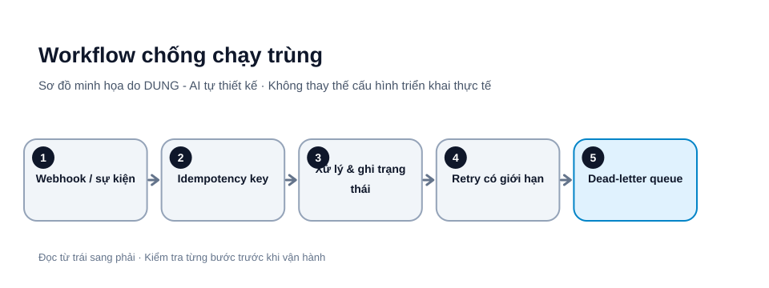

# Workflow AI bền vững: idempotency, retry và hàng đợi lỗi

Một workflow chạy thành công trong lần thử đầu chưa chắc sẵn sàng vận hành. Mạng có thể ngắt sau khi dịch vụ đã nhận yêu cầu; webhook có thể gửi lại; AI có thể trả JSON sai; hoặc hệ thống đích đã ghi dữ liệu nhưng phản hồi bị mất. Nếu workflow chạy lại toàn bộ mà không có cơ chế bảo vệ, nó có thể tạo bản ghi hoặc gửi email nhiều lần.




*Hình 1. Workflow chống chạy trùng. Sơ đồ tự thiết kế bởi DUNG - AI; các bước và tên thành phần cần điều chỉnh theo môi trường thực tế.*

## 1. Phân loại lỗi trước khi retry

- **Tạm thời:** timeout, kết nối chập chờn, HTTP 429 hoặc một số lỗi 5xx.
- **Dữ liệu:** thiếu trường, sai kiểu, JSON không hợp lệ.
- **Quyền:** token hết hạn, thiếu scope, bị từ chối.
- **Nghiệp vụ:** trạng thái không cho phép, bản ghi đã đóng.
- **Không xác định:** chưa biết hệ thống đích đã thực hiện hành động hay chưa.

Chỉ retry lỗi có khả năng tạm thời. Lỗi dữ liệu cần sửa; lỗi quyền cần xác thực lại; lỗi nghiệp vụ không nên lặp vô hạn.

## 2. Tạo idempotency key

Mỗi sự kiện nên có mã ổn định, ví dụ kết hợp source_system, event_id và action_type rồi băm thành key. Trước khi ghi dữ liệu, kiểm tra key đã được xử lý chưa. Lưu trạng thái started, succeeded hoặc failed cùng kết quả. Nếu sự kiện gửi lại, trả kết quả cũ thay vì tạo hành động thứ hai.

Không tạo key ngẫu nhiên mới mỗi lần retry, vì hệ thống sẽ không nhận ra đó là cùng một yêu cầu.

## 3. Retry có giới hạn

Dùng exponential backoff kèm jitter: thời gian chờ tăng dần và thêm độ ngẫu nhiên để tránh nhiều workflow cùng gọi lại. Đặt số lần tối đa, tổng thời gian tối đa và xử lý HTTP 429 theo hướng dẫn nhà cung cấp.

Không retry thao tác không idempotent nếu chưa biết trạng thái hệ thống đích. Trước khi thử lại, truy vấn trạng thái bằng mã giao dịch hoặc idempotency key.

## 4. Timeout và dead-letter queue

Đặt timeout riêng cho từng bước và giới hạn tổng thời gian workflow. Khi timeout mà chưa biết hành động đã xảy ra hay chưa, đánh dấu trạng thái chưa xác định, không kết luận thất bại chắc chắn.

Sau khi hết retry, chuyển sự kiện sang dead-letter queue kèm event ID, key, bước lỗi, loại lỗi, số lần thử, thời điểm, dữ liệu đã làm sạch bí mật và người phụ trách. Không tự động phát lại toàn bộ hàng đợi lỗi; cần người vận hành phân loại và duyệt.

## Ví dụ triển khai idempotency bằng bảng trạng thái

Với PostgreSQL, có thể bắt đầu bằng bảng tối thiểu sau (điều chỉnh kiểu dữ liệu và cú pháp theo hệ quản trị đang dùng):

```sql
CREATE TABLE processed_events (
  tenant_id TEXT NOT NULL,
  idempotency_key TEXT NOT NULL,
  event_id TEXT NOT NULL,
  action_type TEXT NOT NULL,
  status TEXT NOT NULL,
  response_json JSONB,
  created_at TIMESTAMPTZ NOT NULL DEFAULT NOW(),
  updated_at TIMESTAMPTZ NOT NULL DEFAULT NOW(),
  PRIMARY KEY (tenant_id, idempotency_key)
);
```

Luồng xử lý tham khảo:

1. Xác thực webhook và kiểm tra schema đầu vào.
2. Tạo key ổn định từ `tenant_id + source_system + event_id + action_type`; không đưa thời gian nhận request vào key.
3. Thử tạo bản ghi với khóa duy nhất. Nếu khóa đã tồn tại và trạng thái `succeeded`, trả kết quả đã lưu.
4. Nếu bản ghi đang `processing`, không chạy song song hành động thứ hai; trả trạng thái đang xử lý hoặc xếp hàng chờ.
5. Thực hiện nghiệp vụ và cập nhật kết quả. Với tác động bên ngoài hệ thống (email, thanh toán, CRM), truyền cùng idempotency key cho API đích nếu API đó hỗ trợ.
6. Nếu hệ thống đích đã thực hiện nhưng phản hồi bị mất, truy vấn trạng thái giao dịch trước khi retry.

**Lưu ý giao dịch:** ghi idempotency key và thay đổi dữ liệu nội bộ cần được phối hợp nguyên tử khi có thể. Với side effect bên ngoài, cân nhắc transactional outbox và tiến trình đối soát; một bảng key đơn lẻ không thể tự bảo đảm giao dịch nguyên tử xuyên nhiều dịch vụ.

### Lịch retry minh họa

| Lần thử | Thời gian chờ cơ sở | Hành động |
|---|---:|---|
| Lần đầu | 0 giây | Gửi request |
| Retry 1 | 1 giây + jitter | Chỉ với lỗi tạm thời |
| Retry 2 | 2 giây + jitter | Kiểm tra Retry-After nếu có |
| Retry 3 | 4 giây + jitter | Hết giới hạn thì chuyển DLQ |

Các con số chỉ là cấu hình minh họa; đặt cap và tổng deadline theo SLA, giới hạn API và mức độ quan trọng của tác vụ. Với HTTP 429, ưu tiên tôn trọng `Retry-After` nếu nhà cung cấp trả về. Không tự retry khi trạng thái side effect chưa rõ.

## 5. Kiểm thử tình huống xấu

Mô phỏng webhook gửi cùng event hai lần; hệ thống đích ghi thành công nhưng phản hồi timeout; API trả 429; AI trả JSON thiếu trường; token hết hạn giữa workflow; và một bước thất bại sau khi bước trước đã ghi dữ liệu.

Đối chiếu số hành động thực tế với số sự kiện duy nhất. Mục tiêu là không có tác động trùng và mọi sự kiện lỗi đều truy vết được.

## Mẫu chính sách retry

~~~text
Retryable: timeout, 429, selected 5xx
Max attempts: 4 including first attempt
Backoff: exponential + jitter
Never retry automatically: validation errors, 401/403,
business-rule rejection, unknown non-idempotent outcome
After exhaustion: move to dead-letter queue
Replay: require operator review
~~~

## Checklist

- [ ] Có event ID ổn định và idempotency key.
- [ ] Phân loại lỗi trước khi retry.
- [ ] Backoff, jitter, timeout và số lần thử có giới hạn.
- [ ] Trạng thái chưa xác định không bị coi là thất bại chắc chắn.
- [ ] Có dead-letter queue và người phụ trách.
- [ ] Có kiểm thử webhook lặp và lỗi giữa chừng.

## Nguồn tham khảo

- [AWS Builders' Library – Making retries safe with idempotent APIs](https://aws.amazon.com/builders-library/making-retries-safe-with-idempotent-APIs/)
- [AWS – Retry behavior](https://docs.aws.amazon.com/sdkref/latest/guide/feature-retry-behavior.html) — hành vi retry phụ thuộc SDK và cấu hình; tài liệu hiện hành mô tả một số thay đổi năm 2026 cần bật opt-in bằng `AWS_NEW_RETRIES_2026=true`. Không sao chép mặc định hoặc số lần retry giữa các SDK mà chưa kiểm tra phiên bản đang chạy.
- [Google Cloud – Retry strategy](https://cloud.google.com/storage/docs/retry-strategy) — hướng dẫn của Cloud Storage; cần đối chiếu đặc tính idempotency của API đích.

*Bài viết hướng dẫn chung. Khi sử dụng lại nội dung, vui lòng ghi rõ tác giả: DUNG - AI.*
