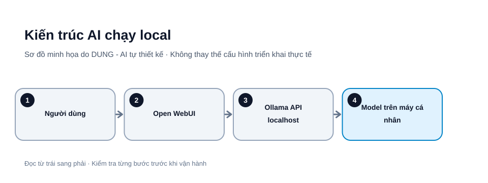

# Chạy AI trên máy cá nhân với Ollama và Open WebUI: hướng dẫn từ A đến Z

Bạn có thể chạy mô hình ngôn ngữ trên máy cá nhân thay vì gửi mọi câu hỏi đến API đám mây. Trong hướng dẫn này, **Ollama** đảm nhiệm việc tải/chạy model, còn **Open WebUI** cung cấp giao diện chat trên trình duyệt.

> **Phạm vi:** hướng dẫn thực hành trên máy tính cá nhân Windows, macOS hoặc Linux. Các lệnh được tham chiếu từ tài liệu chính thức tại thời điểm biên tập; dự án chưa chạy thử trên mọi tổ hợp hệ điều hành/phần cứng. Hãy kiểm tra phiên bản và hướng dẫn mới nhất trước khi thực hiện.



*Hình 1. Luồng xử lý AI local. Sơ đồ tự thiết kế bởi DUNG - AI; đường kết nối thực tế có thể khác nếu chạy Docker hoặc tách Ollama sang máy khác.*

## 1. Bạn sẽ cài những gì?

- **Ollama:** quản lý model và cung cấp runtime/API để ứng dụng gửi prompt đến model.
- **Open WebUI:** giao diện web tự lưu trữ, hỗ trợ Ollama và nhiều API tương thích.
- **Docker Desktop/Docker Engine:** cách đóng gói Open WebUI trong container, giúp cài đặt và cập nhật thuận tiện.

Ollama và Open WebUI có thể được tự lưu trữ mà không phải trả phí phần mềm theo điều kiện giấy phép hiện hành. Riêng Open WebUI từ v0.6.6 có điều khoản bảo vệ thương hiệu: triển khai tổng cộng trên 50 người dùng trong 30 ngày phải giữ thương hiệu Open WebUI, trừ trường hợp được miễn hoặc có giấy phép doanh nghiệp phù hợp. Vì vậy, không đồng nhất “miễn phí” với quyền white-label. **Giấy phép phần mềm cũng không tự động áp dụng cho mọi model**; trước khi dùng model cho mục đích thương mại, phải đọc giấy phép riêng của model.

## 2. Kiểm tra máy trước khi cài

Ghi lại các thông tin sau:

| Hạng mục | Cách kiểm tra | Vì sao cần |
|---|---|---|
| Hệ điều hành | Settings / About | Chọn đúng bộ cài |
| RAM | Task Manager hoặc Activity Monitor | Model và context cần bộ nhớ |
| GPU, VRAM | Task Manager / công cụ của hãng GPU | Có thể tăng tốc suy luận |
| Dung lượng trống | File Explorer / Finder | Model có thể chiếm nhiều GB |
| Docker | `docker --version` | Chạy Open WebUI bằng container |

**Chọn model phù hợp với cấu hình trước.** Ví dụ `gemma4` có nhiều biến thể; thư viện Ollama hiện liệt kê các bản có dung lượng tải xuống từ khoảng 4,6 GB trở lên, nên không mặc định xem đây là model nhẹ cho máy ít RAM. Dung lượng tải xuống không phải toàn bộ lượng RAM cần khi chạy; context dài và nhiều phiên chat có thể tăng mức sử dụng bộ nhớ. Kiểm tra đúng tag, kích thước và yêu cầu trên trang model trước khi tải.

## 3. Cài và kiểm tra Ollama

Mở trang tải chính thức: [ollama.com/download](https://ollama.com/download).

- **Windows:** tải và chạy bộ cài Windows từ trang chính thức.
- **macOS:** tải gói dành cho macOS và làm theo hướng dẫn cài đặt.
- **Linux:** tài liệu chính thức hiện cung cấp lệnh cài đặt:

```bash
curl -fsSL https://ollama.com/install.sh | sh
```

Lệnh trên tải và thực thi script từ website Ollama. Chỉ chạy khi bạn đã xác minh đúng tên miền và chấp nhận cách cài đặt này; môi trường doanh nghiệp nên đọc script và hướng dẫn cài thủ công trước.

Mở Terminal/PowerShell mới và kiểm tra:

```bash
ollama --version
```

**Kết quả mong đợi:** terminal in ra phiên bản Ollama, không báo `command not found` hoặc lỗi không nhận diện lệnh.

Nếu không nhận diện được lệnh:
1. Đóng và mở lại Terminal/PowerShell.
2. Kiểm tra Ollama đã cài xong và đang chạy.
3. Trên Windows/macOS, kiểm tra biểu tượng/tiến trình Ollama.
4. Trên Linux, xem trạng thái dịch vụ bằng `systemctl status ollama` nếu cài dưới dạng systemd service.

## 4. Tải model và chat thử

Xem danh sách model và giấy phép tại [Ollama Library](https://ollama.com/library). Ví dụ bên dưới dùng model `gemma4`; nếu model hoặc tag thay đổi, chọn model còn được thư viện chính thức hỗ trợ.

```bash
ollama run gemma4
```

Lần đầu chạy, Ollama tải các tệp model cần thiết. Việc tải có thể mất thời gian và tiêu tốn nhiều dung lượng mạng/ổ đĩa.

Khi xuất hiện dấu nhắc nhập nội dung, thử câu hỏi đơn giản:

```text
Hãy trả lời bằng tiếng Việt: giải thích sự khác nhau giữa RAM và VRAM trong 3 ý.
```

Một số lệnh quản lý hữu ích:

```bash
ollama list
ollama ps
curl http://localhost:11434/api/tags
```

- `ollama list`: xem model đã tải.
- `ollama ps`: xem model đang được nạp/chạy.
- `curl http://localhost:11434/api/tags`: kiểm tra Ollama API trả danh sách model; trong PowerShell Windows, dùng `curl.exe` nếu `curl` đang là alias của PowerShell.

Thoát phiên chat theo hướng dẫn hiển thị trong CLI. Nếu tải nhầm model, không xóa thư mục dữ liệu thủ công; đọc hướng dẫn quản lý model của Ollama trước.

## 5. Cài Open WebUI bằng Docker

### 5.1. Chuẩn bị Docker

Cài Docker Desktop (Windows/macOS) hoặc Docker Engine (Linux) từ trang chính thức của Docker. Khởi động Docker rồi kiểm tra:

```bash
docker --version
docker info
```

Nếu `docker info` báo không kết nối được daemon, hãy mở Docker Desktop hoặc khởi động Docker service trước khi tiếp tục.

### 5.2. Tạo secret và chạy container

Lệnh dưới đây dành cho Docker chạy trên máy cá nhân. Nó giới hạn cổng giao diện ở `127.0.0.1`, nghĩa là chỉ máy đó truy cập được qua localhost; đồng thời giữ dữ liệu trong Docker volume và tạo secret ngẫu nhiên.

**macOS/Linux (Terminal):**

```bash
export WEBUI_SECRET_KEY="$(openssl rand -hex 32)"
docker run -d \
  -p 127.0.0.1:3000:8080 \
  --add-host=host.docker.internal:host-gateway \
  -v open-webui:/app/backend/data \
  -e WEBUI_SECRET_KEY="$WEBUI_SECRET_KEY" \
  --name open-webui \
  --restart always \
  ghcr.io/open-webui/open-webui:main
```

**Windows PowerShell:**

```powershell
$rng = [System.Security.Cryptography.RandomNumberGenerator]::Create()
$secretBytes = New-Object byte[] 32
$rng.GetBytes($secretBytes)
$env:WEBUI_SECRET_KEY = [Convert]::ToBase64String($secretBytes)
$rng.Dispose()
docker run -d -p 127.0.0.1:3000:8080 --add-host=host.docker.internal:host-gateway -v open-webui:/app/backend/data -e WEBUI_SECRET_KEY=$env:WEBUI_SECRET_KEY --name open-webui --restart always ghcr.io/open-webui/open-webui:main
```

Đây là ví dụ tạo secret ngẫu nhiên bằng PowerShell; hãy lưu secret ở nơi an toàn nếu cần khôi phục cấu hình. Không đăng secret lên Git, ảnh chụp màn hình hoặc chat công khai.

Lưu ý phiên bản: tag Docker `:main` là tag rolling, thay đổi theo nhánh phát triển. Khi cần tái lập môi trường, hãy chọn tag release cụ thể (ví dụ `:vX.Y.Z`) sau khi kiểm tra release notes; không tự động nâng cấp image đang lưu dữ liệu nếu chưa sao lưu volume và có phương án rollback.

Giải thích các tham số quan trọng:

- `127.0.0.1:3000:8080`: chỉ publish giao diện trên loopback máy chủ, cổng trình duyệt là 3000.
- `-v open-webui:/app/backend/data`: lưu chat, tài khoản và cài đặt bền vững qua lần khởi động lại.
- `WEBUI_SECRET_KEY`: khóa ổn định để bảo vệ phiên và tránh mất phiên khi container được tạo lại.
- `host.docker.internal`: tên host để container tìm dịch vụ trên máy chủ; cách định tuyến có thể khác tùy Docker và hệ điều hành.

Tài liệu Open WebUI cũng có image `:ollama` gộp Ollama và Open WebUI trong một container. Có thể dùng phương án đó nếu muốn một gói tất-cả-trong-một; đọc đúng phần “Bundled with Ollama” trong tài liệu trước khi thay đổi lệnh.

### 5.3. Kiểm tra giao diện

Mở trình duyệt tại:

```text
http://localhost:3000
```

Tạo tài khoản quản trị đầu tiên theo giao diện. Nếu trang không mở, kiểm tra:

```bash
docker ps
docker logs --tail 100 open-webui
```

**Kết quả mong đợi:** container có trạng thái `Up`, log không lặp lỗi khởi động và trang đăng nhập Open WebUI hiển thị ở localhost.

### 5.4. Kết nối Ollama

Trong Open WebUI, mở:

**Avatar → Settings → Admin Settings → Connections** (tên mục có thể thay đổi theo phiên bản).

Thêm/kiểm tra Ollama API connection. Khi Open WebUI chạy trong Docker và Ollama chạy trực tiếp trên máy chủ, địa chỉ thường dùng là:

```text
http://host.docker.internal:11434
```

Sau đó lưu kết nối và kiểm tra model xuất hiện trong bộ chọn model của cuộc chat mới.

Nếu container không kết nối được Ollama:
1. Xác nhận Ollama đang chạy và `ollama list` có model.
2. Kiểm tra log container: `docker logs --tail 100 open-webui`.
3. Kiểm tra địa chỉ kết nối từ góc nhìn container; `localhost` bên trong container là chính container, không phải máy chủ.
4. Tài liệu Open WebUI lưu ý Ollama trên host phải nhận kết nối từ container khi WebUI chạy bằng Docker. Trên Linux, Ollama thường cần cấu hình `OLLAMA_HOST=0.0.0.0` cho kiểu kết nối này; trên Docker Desktop, `host.docker.internal` giải quyết tên host nhưng firewall và cấu hình lắng nghe vẫn cần được kiểm tra. Chỉ mở listener khi bạn có thể giới hạn nguồn truy cập bằng firewall ở mức cần thiết; không chuyển tiếp cổng 11434 ra Internet hoặc mạng LAN không tin cậy. Phương án gọn hơn là dùng image `:ollama` hoặc đặt hai dịch vụ trong cùng Docker network riêng.

## 6. Kiểm thử trước khi đưa dữ liệu thật vào

Dùng dữ liệu giả lập, không nhạy cảm. Tạo bộ 10 câu hỏi:

1. Tóm tắt một đoạn văn ngắn.
2. Trích xuất tên, ngày và con số.
3. Phân loại phản hồi theo nhãn định trước.
4. Viết lại một đoạn theo định dạng JSON.
5. Trả lời khi dữ liệu đầu vào thiếu.
6. Nêu rõ khi không biết câu trả lời.
7. Phân biệt dữ kiện và suy luận.
8. Xử lý câu hỏi tiếng Việt có dấu.
9. Tóm tắt nội dung dài hơn.
10. Từ chối yêu cầu vượt ngoài phạm vi được giao.

Ghi lại model/tag, cấu hình, thời gian phản hồi và lỗi. Chấm riêng độ đúng, tuân thủ định dạng, mức bịa khi thiếu dữ kiện và tốc độ. Không dùng một câu trả lời trôi chảy làm bằng chứng rằng model đúng.

## 7. Bảo mật, quyền riêng tư và giấy phép

- Local inference giảm việc gửi prompt đến nhà cung cấp AI đám mây, nhưng không bảo vệ khỏi người có quyền truy cập máy, malware, plugin hoặc log.
- Không mở cổng 3000 hoặc 11434 ra Internet khi chưa thiết kế xác thực, TLS, firewall, cập nhật và giám sát.
- Giữ volume dữ liệu; sao lưu trước khi cập nhật hoặc di chuyển container. Không chạy lệnh xóa volume nếu chưa hiểu dữ liệu sẽ mất.
- Open WebUI từ v0.6.6 có điều khoản bảo vệ branding: với triển khai trên 50 người dùng trong bất kỳ giai đoạn 30 ngày liên tiếp nào, không được xóa/che/thay đổi nhận diện Open WebUI nếu không thuộc ngoại lệ hoặc có giấy phép phù hợp. Kiểm tra giấy phép của đúng phiên bản trước khi tùy biến hoặc phân phối.
- Kiểm tra giấy phép riêng của từng model. Tên “open” hoặc việc tải được model không đồng nghĩa mọi mục đích thương mại đều được phép.

## 8. Xử lý lỗi thường gặp

| Triệu chứng | Nguyên nhân có thể | Cách kiểm tra |
|---|---|---|
| `ollama` không được nhận diện | Chưa cài xong hoặc PATH chưa cập nhật | Mở terminal mới, kiểm tra cài đặt |
| Model tải lâu | Model lớn hoặc mạng chậm | Chọn model nhỏ hơn, kiểm tra dung lượng |
| Docker không chạy | Daemon chưa hoạt động | `docker info` |
| Không mở được localhost:3000 | Container dừng hoặc cổng đã bị chiếm | `docker ps -a`, `docker logs` |
| Không thấy model trong WebUI | Sai URL hoặc Ollama chưa chạy | Kiểm tra Ollama, connection và log |
| Mất chat sau khi tạo lại container | Không gắn volume dữ liệu | Luôn giữ `-v open-webui:/app/backend/data` |

## Checklist hoàn tất

- [ ] Đã xác định hệ điều hành, RAM, GPU/VRAM và dung lượng trống.
- [ ] Đã cài Ollama từ nguồn chính thức và kiểm tra phiên bản.
- [ ] Đã tải một model nhỏ, kiểm tra bằng `ollama list` và chat thử.
- [ ] Đã cài Docker và Open WebUI với volume dữ liệu.
- [ ] Đã giới hạn giao diện ở localhost khi thử cá nhân.
- [ ] Đã kết nối WebUI với Ollama và kiểm tra bằng dữ liệu giả lập.
- [ ] Đã đọc giấy phép của Open WebUI đúng phiên bản và của model.
- [ ] Chưa mở cổng ra Internet nếu chưa có cấu hình bảo mật phù hợp.

## Nguồn chính thức

- [Ollama – Download](https://ollama.com/download)
- [Ollama – Documentation](https://docs.ollama.com/)
- [Ollama – Model Library](https://ollama.com/library)
- [Open WebUI – Quick Start](https://docs.openwebui.com/getting-started/quick-start/)
- [Open WebUI – Troubleshooting connection errors](https://docs.openwebui.com/troubleshooting/connection-error/)
- [Open WebUI – License](https://docs.openwebui.com/license/)

*Ngày rà soát nguồn: 31/10/2026. Các lệnh chưa được chạy kiểm chứng trên toàn bộ tổ hợp OS/phần cứng; hãy kiểm tra lại tài liệu theo phiên bản trước khi triển khai. Khi sử dụng lại nội dung, vui lòng ghi rõ tác giả: DUNG - AI.*
