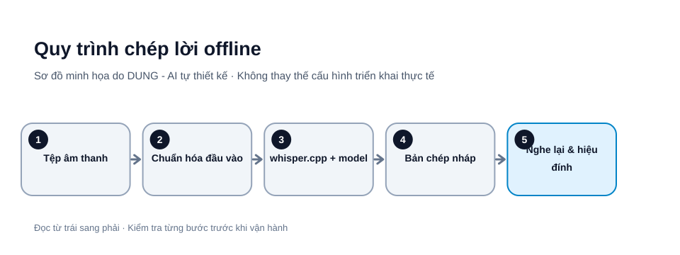

# Chuyển giọng nói thành văn bản offline với whisper.cpp: hướng dẫn từng bước

[whisper.cpp](https://github.com/ggml-org/whisper.cpp) là triển khai C/C++ của mô hình nhận dạng giọng nói Whisper. Công cụ cho phép chạy suy luận cục bộ, phù hợp khi bạn cần chép lời tệp âm thanh mà không muốn gửi bản ghi lên dịch vụ chuyển giọng nói đám mây.

**Lưu ý quan trọng:** “offline” chỉ mô tả bước suy luận sau khi đã tải mã nguồn/model. Cài đặt và tải model ban đầu cần Internet. Bản chép là kết quả máy tạo, không phải biên bản đã xác minh.



*Hình 1. Quy trình xử lý âm thanh bằng whisper.cpp. Sơ đồ tự thiết kế bởi DUNG - AI.*

## 1. Chuẩn bị và điều kiện sử dụng

Bạn cần:

- Máy tính Windows, macOS hoặc Linux.
- Git để tải mã nguồn.
- CMake và trình biên dịch C/C++ phù hợp.
- FFmpeg để chuyển đổi âm thanh đầu vào khi cần.
- Kết nối Internet ở bước tải mã nguồn và model.
- Dung lượng ổ đĩa đủ cho mã nguồn, model và tệp âm thanh.

Trước khi xử lý, xác nhận bạn có quyền ghi âm và xử lý tệp. Nếu là cuộc họp/phỏng vấn, tuân thủ quy định thông báo và đồng ý ghi âm áp dụng. Không dùng bản ghi có dữ liệu cá nhân hoặc bí mật nếu chưa được phép.

## 2. Chọn model phù hợp

whisper.cpp dùng các model được chuyển sang định dạng GGML. Dự án cung cấp nhiều mức như `tiny`, `base`, `small`, `medium`, `large` và các biến thể. Hậu tố `.en` dành cho model tiếng Anh; để nhận dạng tiếng Việt, hãy chọn model đa ngôn ngữ, ví dụ `base`, không chọn `base.en`.

Bảng kích thước và bộ nhớ tham khảo do repository công bố (có thể thay đổi theo phiên bản/model build):

| Model | Dung lượng lưu trữ tham khảo | Bộ nhớ tham khảo |
|---|---:|---:|
| tiny | 75 MiB | ~273 MB |
| base | 142 MiB | ~388 MB |
| small | 466 MiB | ~852 MB |
| medium | 1.5 GiB | ~2.1 GB |
| large | 2.9 GiB | ~3.9 GB |

Đây là số liệu tham khảo của dự án, không phải cấu hình bảo đảm chạy mượt trên mọi máy. Bộ nhớ thực tế còn phụ thuộc backend, số luồng, độ dài âm thanh và các tiến trình khác. Bắt đầu bằng `base`; nếu chất lượng chưa đạt, thử `small` trên một đoạn mẫu rồi so sánh tốc độ và độ chính xác.

## 3. Cài công cụ cần thiết

### Ubuntu/Debian

Mở Terminal:

```bash
sudo apt update
sudo apt install -y git cmake build-essential ffmpeg
```

### macOS

Nếu đã có Homebrew:

```bash
brew install git cmake ffmpeg
```

### Windows

Cài Git for Windows, CMake và Visual Studio Build Tools với workload C++ phù hợp. Mở Developer PowerShell có compiler trong PATH. Repository có script tải model riêng cho Windows; sau khi clone, từ thư mục gốc chạy:

```powershell
.\models\download-ggml-model.cmd base
```

Tài liệu whisper.cpp hỗ trợ Windows qua MSVC và MinGW; đường dẫn binary sau khi build có thể khác theo generator.

Kiểm tra công cụ:

```bash
git --version
cmake --version
ffmpeg -version
```

Trên Windows, mở Developer PowerShell cho Visual Studio rồi build bằng MSVC:

```powershell
cmake -B build -A x64
cmake --build build --config Release --parallel
```

Nếu CMake không tìm được Visual Studio generator, cài Visual Studio Build Tools với workload Desktop development with C++, mở lại Developer PowerShell và thử lại. Binary MSVC thường nằm tại `build\bin\Release\whisper-cli.exe`.

## 4. Tải mã nguồn và build whisper.cpp

Trong Terminal/PowerShell, chuyển tới thư mục bạn muốn lưu dự án, sau đó:

```bash
git clone https://github.com/ggml-org/whisper.cpp.git
cd whisper.cpp
cmake -B build
cmake --build build --config Release -j
```

**Kết quả mong đợi:** CMake cấu hình thành công và trình biên dịch hoàn tất không có lỗi. Trên Linux/macOS, binary thường nằm tại `build/bin/whisper-cli`; với Visual Studio trên Windows, có thể nằm trong thư mục cấu hình như `build/bin/Release/whisper-cli.exe`.

Kiểm tra trợ giúp của chính binary vừa build:

```bash
./build/bin/whisper-cli -h
```

Trên Windows, gọi đường dẫn `whisper-cli.exe` tương ứng. Đây là cách kiểm tra cú pháp chính xác theo phiên bản đã build, vì tùy chọn CLI có thể thay đổi.

## 5. Tải model đa ngôn ngữ

Từ thư mục gốc `whisper.cpp`, chạy:

```bash
sh ./models/download-ggml-model.sh base
```

Script tải model `base` đa ngôn ngữ và lưu trong thư mục `models/`. 

**Kết quả mong đợi:** xuất hiện tệp model tương tự `models/ggml-base.bin`. Kiểm tra tệp tồn tại và dung lượng không bằng 0. Không đổi tên hoặc di chuyển model nếu chưa cập nhật đường dẫn trong lệnh chạy.

## 6. Chuẩn hóa âm thanh đầu vào

README của whisper.cpp nêu ví dụ CLI `whisper-cli` xử lý WAV PCM 16-bit. Nếu nguồn là MP3, M4A hoặc định dạng khác, có thể chuyển bằng FFmpeg:

```bash
ffmpeg -i "ban-ghi.mp3" -ar 16000 -ac 1 -c:a pcm_s16le "ban-ghi-16k-mono.wav"
```

Ý nghĩa:
- `-ar 16000`: đặt sample rate 16 kHz.
- `-ac 1`: chuyển thành mono.
- `-c:a pcm_s16le`: mã hóa PCM signed 16-bit little-endian.

Kiểm tra tệp sau chuyển đổi:

```bash
ffprobe -hide_banner "ban-ghi-16k-mono.wav"
```

Nếu FFmpeg báo lỗi, kiểm tra đường dẫn tệp, dấu ngoặc kép và quyền đọc/ghi. Giữ nguyên tệp gốc; chỉ xử lý bản sao đã chuẩn hóa.

## 7. Chạy nhận dạng tiếng Việt

Chạy lệnh từ thư mục gốc repository:

```bash
./build/bin/whisper-cli \
  -m models/ggml-base.bin \
  -f "ban-ghi-16k-mono.wav" \
  -l vi
```

Trên Windows, thay đường dẫn binary bằng `build/bin/Release/whisper-cli.exe` nếu đó là vị trí build thực tế.

- `-m`: đường dẫn model.
- `-f`: tệp âm thanh đầu vào.
- `-l vi`: chỉ định ngôn ngữ tiếng Việt, tránh phụ thuộc hoàn toàn vào tự nhận diện.

README CLI hiện hành liệt kê `-l LANG`, `-otxt` và `-of FNAME`. Sau khi build, luôn chạy `whisper-cli -h` để xác nhận các tùy chọn của đúng phiên bản bạn đang dùng; không tự thay tham số bằng phỏng đoán.

Để lưu bản chép dạng văn bản, kiểm tra các tùy chọn output trong `whisper-cli -h`; nhiều phiên bản hỗ trợ `-otxt` và `-of`. Ví dụ sau chỉ dùng khi hai tùy chọn đó xuất hiện trong phần trợ giúp:

```bash
./build/bin/whisper-cli -m models/ggml-base.bin -f "ban-ghi-16k-mono.wav" -l vi -otxt -of "ket-qua"
```

PowerShell (MSVC build):

```powershell
.\build\bin\Release\whisper-cli.exe -m .\models\ggml-base.bin -f .\ban-ghi-16k-mono.wav -l vi -otxt -of .\ket-qua
```

**Kết quả mong đợi:** terminal hiển thị các đoạn văn bản kèm mốc thời gian. Nếu âm thanh không phải tiếng Việt hoặc có nhiều ngôn ngữ, chạy thử một đoạn ngắn với thiết lập phù hợp rồi so sánh.

## 8. Hiệu đính bản chép

Không dùng nguyên văn bản máy để phát hành hoặc làm biên bản chính thức khi chưa kiểm tra. Thực hiện ba lượt:

1. **Nghe đối chiếu:** nghe lại các đoạn có câu cụt, lặp, mất tiếng hoặc bản chép không tự nhiên.
2. **Kiểm tra thực thể:** xác minh tên người, địa danh, tổ chức, mã sản phẩm, ngày tháng, số tiền, đơn vị và thuật ngữ.
3. **Kiểm tra ý nghĩa:** đặc biệt chú ý từ phủ định, số lượng, thời hạn, điều kiện và câu mệnh lệnh vì chỉ một từ sai có thể đảo nghĩa.

Không tự điền phần âm thanh không nghe rõ bằng suy đoán. Gắn nhãn `[không nghe rõ]` và mốc thời gian để người có trách nhiệm xác minh.

## 9. Đánh giá chất lượng có kiểm soát

Tạo bộ mẫu gồm 5–10 đoạn ngắn, có bản chép thủ công đã được người nghe xác nhận. Bao gồm giọng phổ thông, giọng địa phương, tên riêng, số liệu và đoạn có tiếng ồn. So sánh kết quả của `base` với `small` trên cùng máy.

Có thể dùng Word Error Rate (WER) để so sánh tổng quát:

```text
WER = (S + D + I) / N
S: số từ thay thế; D: số từ bị xóa; I: số từ chèn; N: số từ trong bản chuẩn
```

WER thấp hơn thường tốt hơn, nhưng không phản ánh đầy đủ mức độ nghiêm trọng của từng lỗi. Một lỗi sai tên người hoặc số tiền có thể quan trọng hơn nhiều lỗi dấu câu. Vì vậy, phải kiểm tra lỗi trọng yếu riêng.

## 10. Bảo mật dữ liệu và giấy phép

- Giữ bản gốc ở vị trí có kiểm soát truy cập; hạn chế người được đọc bản ghi và bản chép.
- Mã hóa ổ đĩa khi phù hợp, đặt thời hạn lưu/xóa tệp tạm và không đồng bộ lên dịch vụ cloud ngoài ý muốn.
- Không chia sẻ transcript lên công cụ khác nếu chưa có quyền.
- Repository whisper.cpp công bố giấy phép MIT; giữ thông báo bản quyền và giấy phép khi phân phối bản sao theo điều kiện áp dụng.
- Model Whisper và các thành phần phụ thuộc cần được rà soát giấy phép riêng. Không suy luận giấy phép của toàn bộ hệ thống chỉ từ giấy phép repository.
- FFmpeg có thể được build với các cấu hình/codec khác nhau; nếu phân phối lại binary, kiểm tra giấy phép của bản build và thư viện đi kèm.

## 11. Lỗi thường gặp

| Lỗi | Nguyên nhân thường gặp | Hướng xử lý |
|---|---|---|
| CMake không tìm thấy compiler | Chưa cài build tools hoặc PATH sai | Kiểm tra compiler, mở đúng Developer Shell |
| Build thất bại | Thiếu CMake/compiler hoặc môi trường không tương thích | Đọc lỗi đầu tiên, kiểm tra yêu cầu trong README |
| Không tìm thấy model | Sai đường dẫn hoặc chưa tải xong | Kiểm tra `models/ggml-base.bin` |
| Không mở được tệp âm thanh | Định dạng không được hỗ trợ hoặc đường dẫn sai | Chuyển sang WAV PCM 16-bit bằng FFmpeg |
| Nhận dạng sai ngôn ngữ | Model English-only hoặc tự nhận diện sai | Dùng model đa ngôn ngữ và `-l vi` nếu CLI hỗ trợ |
| Máy chạy quá chậm | Model quá lớn hoặc thiếu bộ nhớ | Thử model nhỏ hơn, đóng ứng dụng khác |
| Bỏ sót tên riêng/số liệu | Chất lượng âm thanh hoặc giới hạn nhận dạng | Nghe đối chiếu và hiệu đính thủ công |

## Checklist hoàn tất

- [ ] Có quyền xử lý bản ghi âm.
- [ ] Đã cài Git, CMake, compiler và FFmpeg từ nguồn tin cậy.
- [ ] Đã build whisper.cpp từ repository chính thức.
- [ ] Đã tải model đa ngôn ngữ, không nhầm model hậu tố `.en`.
- [ ] Đã chuyển âm thanh sang WAV PCM 16-bit nếu cần.
- [ ] Đã chạy thử đoạn ngắn và kiểm tra cú pháp theo `whisper-cli -h`.
- [ ] Đã hiệu đính tên riêng, số liệu, từ phủ định và nội dung quan trọng.
- [ ] Đã bảo vệ bản ghi, bản chép và kiểm tra giấy phép.

## Nguồn chính thức

- [whisper.cpp – Repository và README](https://github.com/ggml-org/whisper.cpp)
- [whisper.cpp – Model download scripts](https://github.com/ggml-org/whisper.cpp/tree/master/models)
- [whisper.cpp – Windows model downloader](https://github.com/ggml-org/whisper.cpp/blob/master/models/download-ggml-model.cmd)
- [whisper.cpp – CLI options](https://github.com/ggml-org/whisper.cpp/blob/master/examples/cli/README.md)
- [OpenAI Whisper – Repository](https://github.com/openai/whisper)
- [FFmpeg – Documentation](https://ffmpeg.org/documentation.html)
- [CMake – Documentation](https://cmake.org/documentation/)

*Ngày rà soát nguồn: 31/10/2026. Bản hướng dẫn chưa được kiểm thử thực tế trên mọi hệ điều hành; cần chạy thử trên môi trường đích trước khi xuất bản. Khi sử dụng lại nội dung, vui lòng ghi rõ tác giả: DUNG - AI.*
